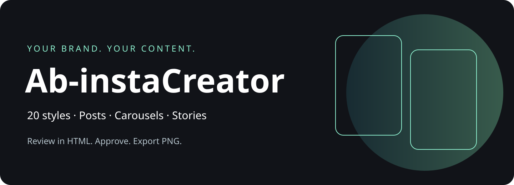
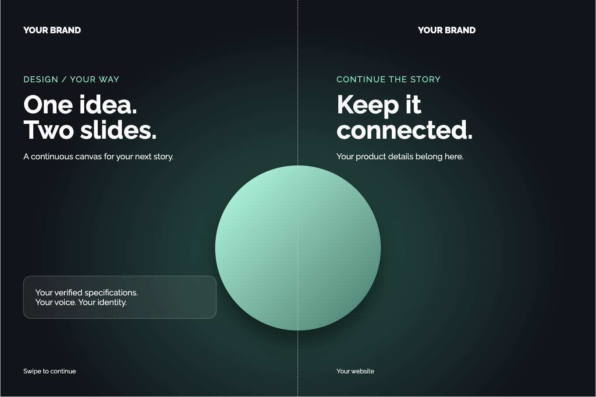
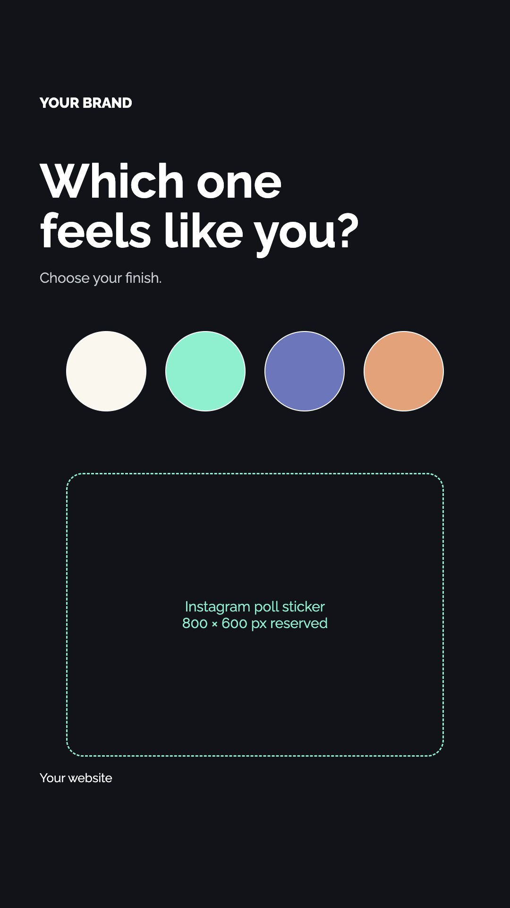

# Ab-instaCreator

**أعطه صور المنتج ورابط التفاصيل. راجع التصاميم في صفحة واحدة، واختر ما تريد تصديره.**

بوستات، كاروسيل متصل، وستوري بهويتك. 20 دليل ستايل، مقاسات واضحة، نصوص قابلة للمراجعة، ثم ملفات PNG وكابشن بخمسة هاشتاقات.



[English guide](README.en.md) · [دليل الستايلات](Ab-instaCreator-v0.1.0.zip) · [مثال الكاروسيل](Ab-instaCreator-v0.1.0.zip) · [سجل التغييرات](CHANGELOG.md)

## 👀 أمثلة وماذا تستلم

| نوع التصميم | النتيجة |
|---|---|
| كاروسيل Glassmorphism | سلايدان من مشهد واحد؛ العنصر يكمل عبر الحد الفاصل |
| ستوري Minimalism | عنوان واضح ومساحة كبيرة لملصق التصويت |
| صفحة المراجعة | تبويبات للبوستات والستوري، واسم الستايل والنسخة تحت كل خيار |




الأمثلة هندسية أصلية لتوضيح الآلية. صور المنتجات الفعلية تأتي من ملفاتك؛ لا ندّعي أن الأمثلة إعلانات منشورة.

## 🚀 ابدأ هنا: تثبيت، إعداد، تصميم

### 1. حمّل الإضافة وثبّتها

حمّل [الحزمة الكاملة](Ab-instaCreator-v0.1.0.zip)، وفك الضغط، ثم استخدم المسار الكامل للمجلد الناتج في الأمر التالي. التوزيع الحالي كحزمة ZIP تحتوي المصدر كاملًا؛ تثبيت السوق مباشرة من رابط GitHub غير متاح في هذا الإصدار.

هذا المستودع **خاص حاليًا**. تحتاج حسابًا لديه صلاحية الوصول. الاسم على GitHub هو `Ab-instaCreator`، واسم الإضافة التقني هو `ab-instacreator`.

1. افتح Terminal على Mac أو PowerShell على Windows.
2. اكتب `claude --version`. إذا لم يظهر رقم إصدار، ثبّت Claude Code من [التوثيق الرسمي](https://code.claude.com/docs/en/overview).
3. فك الحزمة في مجلد تحتفظ به، واستبدل `/absolute/path/to/Ab-instaCreator` بمساره الحقيقي. على Windows استخدم المسار الكامل بين علامتي تنصيص.
4. نفّذ الأوامر واحدًا واحدًا:


```bash
claude plugin marketplace add /absolute/path/to/Ab-instaCreator
claude plugin marketplace list
claude plugin install ab-instacreator@ab-instacreator
```

افتح جلسة جديدة ثم اطلب التصميم. هذه الأوامر لـClaude Code. استخدام Claude العادي أو الجوال يعتمد على دعم الإضافات والأدوات في حسابك؛ لا نفترض أن ملفات الكمبيوتر أو أدوات التصدير متاحة هناك.

لتجربة المجلد محليًا قبل تثبيت السوق:

```bash
claude --plugin-dir /absolute/path/to/Ab-instaCreator
```

في Codex، انسخ **المجلد كاملًا** `skills/insta-creator` إلى مجلد المهارات الذي تستخدمه، مثل `~/.agents/skills/insta-creator`، ثم افتح جلسة جديدة. احتفظ بالسكربتات والمراجع والخط داخل المجلد. هذه طريقة مهارة محلية؛ ليست ادعاءً أن سوق Claude يثبت داخل Codex.

### 2. الإعداد: أول مرة

افتح جلسة Claude Code جديدة واكتب:

```text
/ab-instacreator:insta-setup
```

إذا لم يظهر الأمر، نفّذ `claude plugin list` وتحقق أن الإضافة مفعّلة، ثم أعد فتح الجلسة.

أعطه هويتك

اسم العلامة، الشعار، الألوان، الخط، اللغة، الموقع والحساب. أرفق كابشن سابق إذا تريد نفس أسلوب الكتابة. لا توجد علامة تجارية مفروضة. خط Raleway موجود كخيار إنجليزي؛ اختر خطًا عربيًا مناسبًا عند كتابة العربية.

### 3. أول تصميم

```text
/ab-instacreator:insta سوّ كاروسيل سلايدين لهذا المنتج، 3 ستايلات، الصور في المجلد وهذا رابط التفاصيل.
```

أو أرفق الصور واكتب طلبك

> «سوّ لي كاروسيل من سلايدين لهذا المنتج. المعلومات من هذا الرابط، والصور في هذا المجلد. ورّني 3 ستايلات.»

تستلم HTML للمراجعة. قل ما تريد تعديله، ثم «صدّر النسخة الثانية». التصدير يعطيك الصور والكابشن، ولا ينشر على حسابك.

## ماذا يحدث بعد الطلب؟

| المرحلة | ما يحدث |
|---|---|
| المعلومات | يقرأ الرابط ويفصل الحقائق المؤكدة عن الناقص |
| التصميم | يبني التكوين والخطوط والصور حسب هويتك والستايل |
| المراجعة | يضيف كل خيار إلى HTML، وتطلب التعديل أو تختار نسخة |
| التصدير | بعد الموافقة يعطيك PNG بالحجم الأصلي وكابشن بخمسة هاشتاقات |

## الأوامر

| الأمر | الاستخدام |
|---|---|
| `/ab-instacreator:insta-setup` | إعداد الهوية |
| `/ab-instacreator:insta` | إنشاء التصميم |
| `/ab-instacreator:insta-styles` | مقارنة الستايلات |
| `/ab-instacreator:insta-export` | تصدير النسخة المعتمدة |

تقدر تطلب نفس الشي باللغة العادية. أسماء الأوامر قد تظهر في واجهة المضيف مع اسم الإضافة.

## ماذا تقدر تسوي؟

| تريد | اكتب |
|---|---|
| بوست منتج | «صورة واحدة، المنتج كبير ومعه أهم المواصفات» |
| كاروسيل متصل | «صورتان للمنتج، كل زاوية بسلايد، والتصميم متصل» |
| عدة خيارات | «اعطني 5 ستايلات مختلفة، واكتب اسم كل ستايل تحت التصميم» |
| ستوري | «حوّل الفكرة إلى ستوري، وأعد ترتيب العناصر للمقاس» |
| ستوري تصويت | «اعرض الألوان واترك مساحة كبيرة لملصق تصويت من 4 خيارات» |
| تعديل محدد | «خلي الستايل نفسه، عدّل اتصال السلايدين فقط» |
| عرض الإدارة | «أضف التصاميم إلى صفحة المراجعة بتبويبات» |
| تصدير | «صدّر النسخة المعتمدة PNG ومعها الكابشن» |

## 20 ستايل

Minimalism · Maximalism · Futuristic · Vector Art · Collage · Retro · Cyberpunk · Pop Art · Glassmorphism · Clay · Pixel Art · Editorial · Y2K · Swiss · Surreal · Bohemian · Victorian-inspired · Graffiti · Aurora · Handwritten.

كل ستايل له دليل تكوين وخطوط وخامات وفحص جودة. المساعد يصمم النتيجة حسب المنتج والهوية؛ ليست 20 فلاتر جاهزة تعيد نفس التصميم بألوان مختلفة. يوجد مثال تقني قابل للتعديل للكاروسيل وآخر للستوري.

## المقاسات والخطوط

| النوع | المقاس |
|---|---|
| بوست / كل سلايد كاروسيل افتراضي | 1080 × 1440 |
| بوست 4:5 عند الطلب | 1080 × 1350 |
| مربع عند الطلب | 1080 × 1080 |
| ستوري / تصويت | 1080 × 1920 |

الهوية تتحكم بالألوان والخطوط والشعار. النصوص تصفّ ككتلة واضحة، بدون تمديد الحروف. الشعار يبقى كاملًا. مساحة ملصق التصويت تظهر كدليل في المعاينة وتختفي عند التصدير.

## كيف تظهر النتائج؟

صفحة HTML رئيسية بتبويبات للبوستات والستوري أو فئات تختارها. كل تصميم له اسم الستايل ورقم النسخة وحالتها. الكاروسيل يُعرض متصلًا أو كسلايدات منفصلة. التعديلات تبقى بنسخ جديدة. الملفات المعتمدة تصدّر بالحجم الحقيقي؛ لا تُصوّر لقطة شاشة مصغرة من المعاينة.


هذا مثال هندسي أصلي لشرح اتصال السلايدات، وليس إعلان منتج حقيقي.

## الكتابة والمعلومات

- المعلومات من رابط المنتج أو المصادر التي تعطيها، مع الاحتفاظ بالمصدر.
- الكابشن: افتتاحية قصيرة، تفاصيل مفيدة، دعوة واضحة، **خمسة هاشتاقات فقط**.
- اللغة والنبرة من هويتك وأمثلتك.
- لا يخترع أسعارًا أو عروضًا أو مخزونًا أو مواصفات.
- التصدير والموافقة والنشر حالات مختلفة. لا توجد أداة نشر تلقائي في هذه النسخة.

## المتطلبات

مساعد يستطيع قراءة الملفات وتعديلها وتصفح المصادر. للتصدير المحلي: Node.js وPython 3 وPlaywright مع Chromium. أدوات قص الخلفية أو توليد الصور تعتمد على ما توفره بيئة المساعد، وليست خدمة مضمّنة. اشتراك المساعد وأي خدمات خارجية منفصلان.

من داخل المجلد:

```bash
npm install
npx playwright install chromium
node skills/insta-creator/scripts/export.cjs skills/insta-creator/templates/scene.html output/demo --approved
```

`--approved` يعني أنك وافقت بالفعل. المثال الهندسي للتجربة فقط. لا يعاد الكتابة فوق صور موجودة. للتصميم التالي اختر مجلدًا أو رقم نسخة جديدًا.

إنشاء صفحة مراجعة:

```bash
python3 skills/insta-creator/scripts/gallery.py skills/insta-creator/examples/review.example.json output/review.html
```

## الخصوصية

لا توجد مفاتيح API، أو رفع تلقائي للصور، أو تتبع استخدام داخل السكربتات. الصور والمعلومات التي ترسلها للمساعد تخضع لبيئته وسياساته؛ أدوات التوليد الخارجية قد تعالج الصور خارج جهازك. ملفات الهوية والعمل الخاصة تبقى في مشروع المستخدم، خارج مستودع الإضافة.

## ما اختُبر؟

تم اختبار توليد صفحة المراجعة وتصدير مثال الكاروسيل والستوري محليًا على macOS/Chrome. أدلة الستايلات تعليمات تصميم تحتاج مراجعة بصرية في كل مهمة. لم يُختبر تثبيت الإضافة في كل تطبيق أو على الهاتف؛ لا نعد بتشغيل موحد عبر كل الأجهزة.

## تحديث الإضافة

حمّل الحزمة الجديدة وفكها إلى المجلد المحلي نفسه، ثم نفّذ:

```bash
claude plugin update ab-instacreator@ab-instacreator
```

[تفاصيل التشغيل والاختبار](Ab-instaCreator-v0.1.0.zip) · [مرجع إضافات Claude الرسمي](https://code.claude.com/docs/en/plugins)

## 🧰 لو صار شيء

| المشكلة | الحل |
|---|---|
| الرابط يقول 404 | المستودع خاص؛ سجّل الدخول بالحساب الذي لديه صلاحية |
| الإضافة لا تظهر | تحقق من `claude plugin list` وأعد فتح الجلسة |
| Cannot find module playwright | نفّذ `npm install` من مجلد الحزمة |
| Chromium غير موجود | نفّذ `npx playwright install chromium` |
| صورة المنتج لا تظهر | حافظ على مجلد assets ومساراته النسبية عند نقل المشروع |
| الخط العربي غير متصل | اختر خطًا عربيًا متاحًا وافحص RTL؛ Raleway للإنجليزية |
| التصدير يرفض الكتابة | الملف موجود؛ اختر نسخة جديدة بدل استبدال المعتمد |
| المعاينة تظهر لكن PNG غير صحيح | افحص export CSS وأزل تحجيم الحاويات أثناء التصدير |
| تريد مشاركة HTML | شارك المجلد كاملًا أو ZIP؛ رابط file المحلي لا يعمل عند الآخرين |

## تجربة سريعة بدون صور شخصية

نفّذ أوامر المتطلبات أعلاه، ثم افتح `skills/insta-creator/templates/scene.html` في المتصفح. بدّل العرض المتصل والمنفصل، وجرّب تصدير المثال. افتح `templates/story.html` لرؤية مساحة التصويت. لا تستخدم النصوص التجريبية كإعلان حقيقي.

## ما داخل الحزمة؟

`commands/` للأوامر، و`skills/insta-creator/` للتعليمات والمراجع والستايلات والخط والأمثلة والسكربتات، و`tests/` للفحوصات. كل المشروع قابل للقراءة والتعديل. لا يحتاج اتصالًا بحساب Instagram لإنشاء التصميم.
