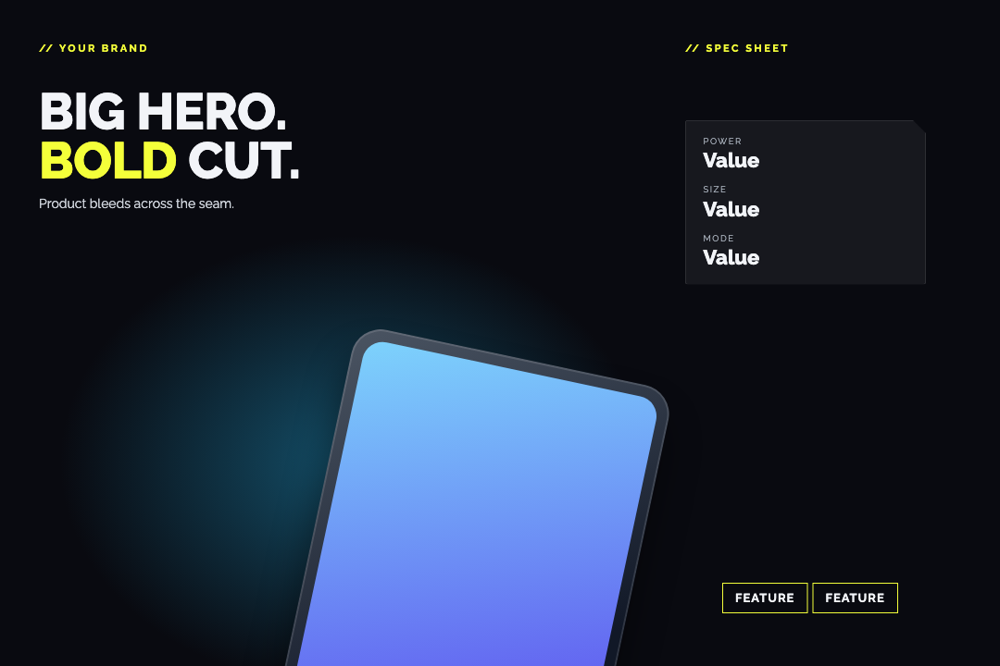
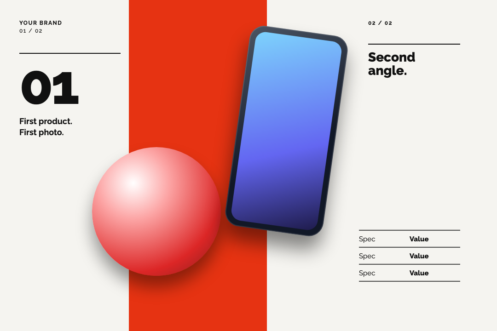
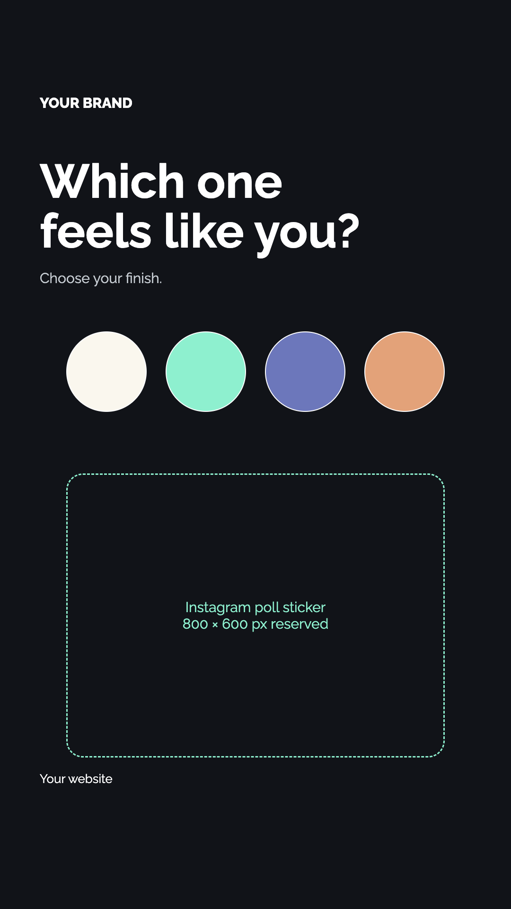
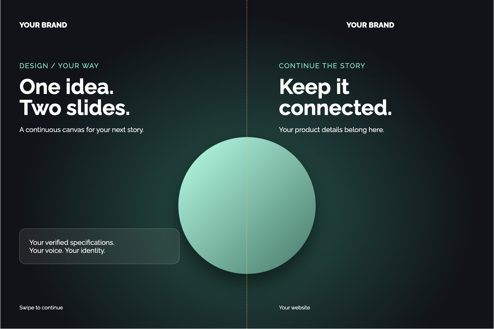

# Ab-instaCreator

**بوستات انستقرام وكاروسيل متصل وستوري، يصممها مساعدك الذكي.** أعطه صور المنتج ورابط التفاصيل وهويتك. يبني تصاميم قابلة للتعديل بأكثر من ستايل وأكثر من تخطيط، تراجعها في صفحة واحدة، ثم يصدّر ملفات PNG المعتمدة وكابشن بخمسة هاشتاقات.

يعمل مع **Claude Code** و**Codex**. لا ينشر على انستقرام نيابةً عنك.


[English guide](README.en.md) · [دليل الستايلات](skills/insta-creator/references/styles.md) · [أنماط التخطيط](skills/insta-creator/references/layout-patterns.md) · [سجل التغييرات](CHANGELOG.md)

## ماذا يصنع؟

| النوع | النتيجة |
|---|---|
| **بوستات** | تصميم منفرد 1080×1440 (أو 1080×1350 / 1080×1080) |
| **كاروسيل متصل** | 2–3 سلايدات من مشهد واحد؛ المنتج يكمل عبر السحب |
| **ستوري** | 1080×1920 مع مساحة نظيفة لملصق التصويت |

**20 دليل ستايل:** مينيمال، ماكسيمال، مستقبلي، فيكتور، كولاج، ريترو، سايبربانك، بوب آرت، زجاجي، كلاي، بيكسل، إديتوريال، Y2K، سويسري، سريالي، بوهيمي، فيكتوري، غرافيتي، أورورا، خط يد.

**4 أنماط تخطيط:** منتج في منتصف الحد الفاصل · منتج خارج المركز يتجاوز الحد · صورة مختلفة لكل سلايد (2–3 صور) · منتج كبير مقصوص مع زاوية ثانية صغيرة. المساعد ينوّع التخطيطات بين الخيارات.

ويشمل: ملف هوية (شعار، ألوان، خطوط، لغة)، حفظ معلومات المنتج مع مصدرها، صفحة مراجعة بتبويبات، وتصدير لا يتم إلا بعد موافقتك.

## 👀 معرض الأمثلة

أمثلة هندسية محايدة؛ صورك وشعارك ونصوصك تحلّ مكان النصوص التجريبية.

| مينيمال · منتج على الحد | سايبربانك · منتج خارج المركز |
|---|---|
|  |  |

| سويسري · صورة لكل سلايد | ستوري · مساحة التصويت |
|---|---|
|  |  |

كاروسيل زجاجي متصل:



## 🚀 ابدأ هنا: تثبيت، إعداد، تصميم

### 1. التثبيت

تحتاج: Node.js 18+ وPython 3 وClaude Code أو Codex. المستودع **خاص**: حسابك على GitHub يجب أن يملك صلاحية الوصول، وgit يجب أن يكون مسجّل الدخول (أسهل طريقة: `gh auth login`).

**Claude Code (إضافة):**

```bash
claude plugin marketplace add abhjz/Ab-instaCreator
claude plugin install ab-instacreator@ab-instacreator
```

أو من مجلد محلي (حمّل ZIP وفكّه):

```bash
claude plugin marketplace add /absolute/path/to/Ab-instaCreator
claude plugin install ab-instacreator@ab-instacreator
```

للتجربة بدون تثبيت: `claude --plugin-dir /absolute/path/to/Ab-instaCreator`

**Codex (مهارة):**

```bash
git clone https://github.com/abhjz/Ab-instaCreator.git
cd Ab-instaCreator
./install.sh codex
```

ينسخ المهارة إلى `~/.agents/skills/insta-creator`. لمجلد مختلف: `CODEX_SKILLS_DIR=~/.codex/skills ./install.sh codex`. الأمر `./install.sh all` يثبّتها في Claude وCodex معًا كمهارة.

**إعداد التصدير (مرة واحدة، للاثنين):**

```bash
bash skills/insta-creator/scripts/setup.sh
```

يثبّت Playwright وChromium في `~/.ab-instacreator` ويبقى بعد التحديثات. أو قل للمساعد: «جهّز أدوات التصدير».

**افتح جلسة جديدة بعد التثبيت.** في Claude تبدأ الأوامر بـ `/ab-instacreator:`؛ في Codex اذكر `$insta-creator` في طلبك.

### 2. الإعداد: أول مرة

افتح جلسة Claude Code جديدة واكتب:

```text
/ab-instacreator:insta-setup
```

إذا لم يظهر الأمر، نفّذ `claude plugin list` وتحقق أن الإضافة مفعّلة، ثم أعد فتح الجلسة.

أعطه هويتك

اسم العلامة، الشعار، الألوان، الخط، اللغة، الموقع والحساب. أرفق كابشن سابق إذا تريد نفس أسلوب الكتابة. لا توجد علامة تجارية مفروضة. خط Raleway موجود كخيار إنجليزي؛ اختر خطًا عربيًا مناسبًا عند كتابة العربية.

### 3. أول تصميم

```text
/ab-instacreator:insta سوّ كاروسيل سلايدين لهذا المنتج، 3 ستايلات، الصور في المجلد وهذا رابط التفاصيل.
```

أو أرفق الصور واكتب طلبك

> «سوّ لي كاروسيل من سلايدين لهذا المنتج. المعلومات من هذا الرابط، والصور في هذا المجلد. ورّني 3 ستايلات.»

تستلم HTML للمراجعة. قل ما تريد تعديله، ثم «صدّر النسخة الثانية». التصدير يعطيك الصور والكابشن، ولا ينشر على حسابك.

## ماذا يحدث بعد الطلب؟

| المرحلة | ما يحدث |
|---|---|
| المعلومات | يقرأ الرابط ويفصل الحقائق المؤكدة عن الناقص |
| التصميم | يبني التكوين والخطوط والصور حسب هويتك والستايل |
| المراجعة | يضيف كل خيار إلى HTML، وتطلب التعديل أو تختار نسخة |
| التصدير | بعد الموافقة يعطيك PNG بالحجم الأصلي وكابشن بخمسة هاشتاقات |

## الأوامر

| الأمر | الاستخدام |
|---|---|
| `/ab-instacreator:insta-setup` | إعداد الهوية |
| `/ab-instacreator:insta` | إنشاء التصميم |
| `/ab-instacreator:insta-styles` | مقارنة الستايلات |
| `/ab-instacreator:insta-export` | تصدير النسخة المعتمدة |

تقدر تطلب نفس الشي باللغة العادية. أسماء الأوامر قد تظهر في واجهة المضيف مع اسم الإضافة.

## ماذا تقدر تسوي؟

| تريد | اكتب |
|---|---|
| بوست منتج | «صورة واحدة، المنتج كبير ومعه أهم المواصفات» |
| كاروسيل متصل | «صورتان للمنتج، كل زاوية بسلايد، والتصميم متصل» |
| عدة خيارات | «اعطني 5 ستايلات مختلفة، واكتب اسم كل ستايل تحت التصميم» |
| ستوري | «حوّل الفكرة إلى ستوري، وأعد ترتيب العناصر للمقاس» |
| ستوري تصويت | «اعرض الألوان واترك مساحة كبيرة لملصق تصويت من 4 خيارات» |
| تعديل محدد | «خلي الستايل نفسه، عدّل اتصال السلايدين فقط» |
| عرض الإدارة | «أضف التصاميم إلى صفحة المراجعة بتبويبات» |
| تصدير | «صدّر النسخة المعتمدة PNG ومعها الكابشن» |

## 20 ستايل

Minimalism · Maximalism · Futuristic · Vector Art · Collage · Retro · Cyberpunk · Pop Art · Glassmorphism · Clay · Pixel Art · Editorial · Y2K · Swiss · Surreal · Bohemian · Victorian-inspired · Graffiti · Aurora · Handwritten.

كل ستايل له دليل تكوين وخطوط وخامات وفحص جودة. المساعد يصمم النتيجة حسب المنتج والهوية؛ ليست 20 فلاتر جاهزة تعيد نفس التصميم بألوان مختلفة. يوجد مثال تقني قابل للتعديل للكاروسيل وآخر للستوري.

## المقاسات والخطوط

| النوع | المقاس |
|---|---|
| بوست / كل سلايد كاروسيل افتراضي | 1080 × 1440 |
| بوست 4:5 عند الطلب | 1080 × 1350 |
| مربع عند الطلب | 1080 × 1080 |
| ستوري / تصويت | 1080 × 1920 |

الهوية تتحكم بالألوان والخطوط والشعار. النصوص تصفّ ككتلة واضحة، بدون تمديد الحروف. الشعار يبقى كاملًا. مساحة ملصق التصويت تظهر كدليل في المعاينة وتختفي عند التصدير.

## كيف تظهر النتائج؟

صفحة HTML رئيسية بتبويبات للبوستات والستوري أو فئات تختارها. كل تصميم له اسم الستايل ورقم النسخة وحالتها. الكاروسيل يُعرض متصلًا أو كسلايدات منفصلة. التعديلات تبقى بنسخ جديدة. الملفات المعتمدة تصدّر بالحجم الحقيقي؛ لا تُصوّر لقطة شاشة مصغرة من المعاينة.


هذا مثال هندسي أصلي لشرح اتصال السلايدات، وليس إعلان منتج حقيقي.

## الكتابة والمعلومات

- المعلومات من رابط المنتج أو المصادر التي تعطيها، مع الاحتفاظ بالمصدر.
- الكابشن: افتتاحية قصيرة، تفاصيل مفيدة، دعوة واضحة، **خمسة هاشتاقات فقط**.
- اللغة والنبرة من هويتك وأمثلتك.
- لا يخترع أسعارًا أو عروضًا أو مخزونًا أو مواصفات.
- التصدير والموافقة والنشر حالات مختلفة. لا توجد أداة نشر تلقائي في هذه النسخة.

## المتطلبات

مساعد يستطيع قراءة الملفات وتعديلها وتصفح المصادر. للتصدير المحلي: Node.js وPython 3 وPlaywright مع Chromium. أدوات قص الخلفية أو توليد الصور تعتمد على ما توفره بيئة المساعد، وليست خدمة مضمّنة. اشتراك المساعد وأي خدمات خارجية منفصلان.

من داخل المجلد:

```bash
bash skills/insta-creator/scripts/setup.sh
node skills/insta-creator/scripts/export.cjs skills/insta-creator/templates/scene.html output/demo --approved
```

`--approved` يعني أنك وافقت بالفعل. المثال الهندسي للتجربة فقط. لا يعاد الكتابة فوق صور موجودة. للتصميم التالي اختر مجلدًا أو رقم نسخة جديدًا.

إنشاء صفحة مراجعة:

```bash
python3 skills/insta-creator/scripts/gallery.py skills/insta-creator/examples/review.example.json output/review.html
```

## الخصوصية

لا توجد مفاتيح API، أو رفع تلقائي للصور، أو تتبع استخدام داخل السكربتات. الصور والمعلومات التي ترسلها للمساعد تخضع لبيئته وسياساته؛ أدوات التوليد الخارجية قد تعالج الصور خارج جهازك. ملفات الهوية والعمل الخاصة تبقى في مشروع المستخدم، خارج مستودع الإضافة.

## ما اختُبر؟

تم اختبار Claude Code على macOS: التحقق من الإضافة وتوليد صفحة المراجعة وتصدير مثال الكاروسيل والستوري محليًا على macOS/Chrome. أدلة الستايلات تعليمات تصميم تحتاج مراجعة بصرية في كل مهمة. تثبيت Codex لم يُختبر بعد. لم يُختبر التثبيت في كل تطبيق أو على الهاتف؛ لا نعد بتشغيل موحد عبر كل الأجهزة.

## تحديث الإضافة

```bash
claude plugin marketplace update ab-instacreator
claude plugin update ab-instacreator@ab-instacreator
```

Codex: `git pull && ./install.sh codex`

[تفاصيل التشغيل والاختبار](docs/DEVELOPMENT.md) · [مرجع إضافات Claude الرسمي](https://code.claude.com/docs/en/plugins)

## 🧰 لو صار شيء

| المشكلة | الحل |
|---|---|
| الرابط يقول 404 | المستودع خاص؛ سجّل الدخول بالحساب الذي لديه صلاحية |
| الإضافة لا تظهر | تحقق من `claude plugin list` وأعد فتح الجلسة |
| Playwright not found | نفّذ `bash skills/insta-creator/scripts/setup.sh` |
| Chromium غير موجود | نفس الأمر أعلاه، أو حدّد `CHROME_PATH` لمتصفح Chrome موجود |
| صورة المنتج لا تظهر | حافظ على مجلد assets ومساراته النسبية عند نقل المشروع |
| الخط العربي غير متصل | اختر خطًا عربيًا متاحًا وافحص RTL؛ Raleway للإنجليزية |
| التصدير يرفض الكتابة | الملف موجود؛ اختر نسخة جديدة بدل استبدال المعتمد |
| المعاينة تظهر لكن PNG غير صحيح | افحص export CSS وأزل تحجيم الحاويات أثناء التصدير |
| تريد مشاركة HTML | شارك المجلد كاملًا أو ZIP؛ رابط file المحلي لا يعمل عند الآخرين |

## تجربة سريعة بدون صور شخصية

نفّذ أوامر المتطلبات أعلاه، ثم افتح `skills/insta-creator/templates/scene.html` في المتصفح. بدّل العرض المتصل والمنفصل، وجرّب تصدير المثال. افتح `templates/story.html` لرؤية مساحة التصويت. لا تستخدم النصوص التجريبية كإعلان حقيقي.

## ما داخل الحزمة؟

`commands/` للأوامر، و`skills/insta-creator/` للتعليمات والمراجع والستايلات والخط والأمثلة والسكربتات، و`tests/` للفحوصات. كل المشروع قابل للقراءة والتعديل. لا يحتاج اتصالًا بحساب Instagram لإنشاء التصميم.

## الترخيص
MIT. انظر [LICENSE](LICENSE) و[NOTICE](NOTICE.md) (خط Raleway بترخيص OFL 1.1).
